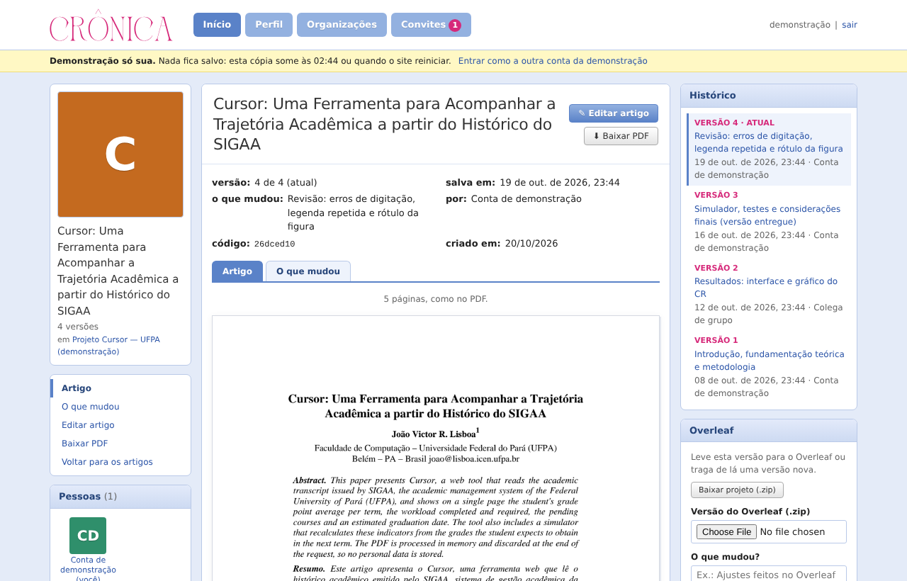
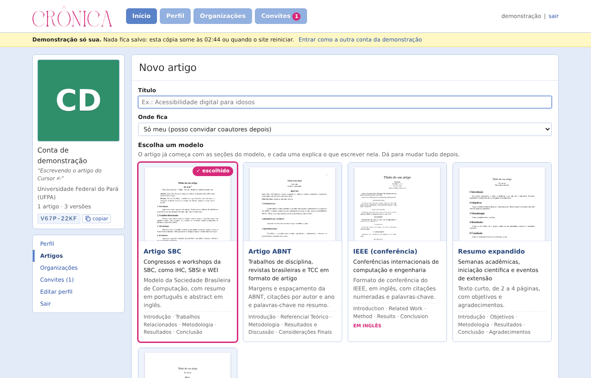
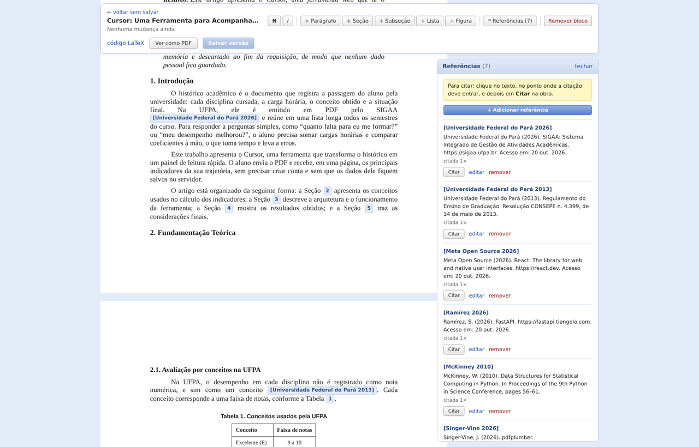
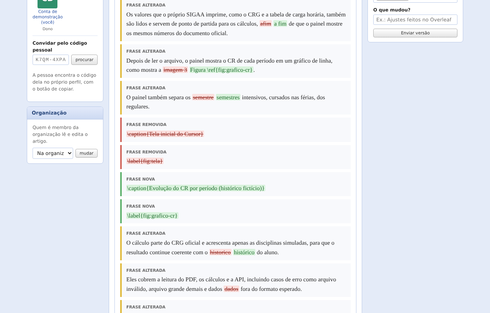
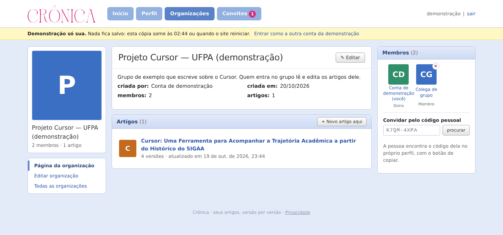
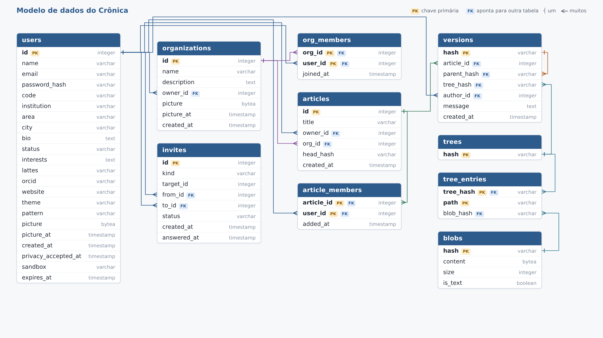

# Crônica

[](https://github.com/joaovictor-rl/Cronica/actions/workflows/tests.yml)

Escreva o artigo no navegador, guarde cada versão e veja **frase a frase** o que mudou entre uma e outra. Pensado para pesquisadores que não programam: não precisa saber LaTeX nem Git. Quem usa o Overleaf pode importar o projeto e levá-lo de volta quando quiser.

**Site:** https://cronica.onrender.com (clique em "Entrar na demonstração" para testar sem criar conta)



## O que dá para fazer

- **Começar de um modelo:** Artigo SBC, Artigo ABNT, IEEE, Resumo expandido ou Em branco. Cada seção já vem com um texto explicando o que escrever nela.
- **Escrever no site**, num editor visual em folhas A4 com a cara do formato (margens, fonte, títulos), ou direto no código LaTeX.
- **Pôr figuras e referências.** As referências podem ser preenchidas num formulário, coladas do Google Acadêmico (BibTeX) ou buscadas pelo DOI. O botão "Citar" põe a citação no estilo do formato: `[Silva 2020]` na SBC, `(SILVA, 2020)` na ABNT, `[1]` no IEEE.
- **Salvar versões** com uma frase dizendo o que mudou, e **ver o que mudou** palavra por palavra.
- **Ler e baixar o PDF** de qualquer versão. O PDF segue as regras do formato: no modelo ABNT, margens, fonte, espaçamento, títulos, legendas, fonte das figuras e referências seguem as NBR 14724, 6022 e 6023; o IEEE sai em duas colunas.
- **Escrever em grupo.** Cada pessoa tem um código pessoal (como `K7QM-4XPA`) para receber convites de coautoria. **Organizações** reúnem um grupo de pesquisa: quem entra lê e edita os artigos dela.
- **Ter um perfil** com foto, frase, interesses, links (Lattes, ORCID, site) e a cor e o desenho do fundo.
- **Usar o Overleaf:** importar o `.zip` do projeto, baixar qualquer versão como `.zip` ou enviar uma versão feita lá.

| Escolher o modelo | Editar com referências |
| --- | --- |
|  |  |
| **Ver o que mudou** | **Escrever em grupo** |
|  |  |

## Como está hospedado

O site é um único programa Python (FastAPI): a mesma aplicação responde a API e entrega a interface.

- **Render** (plano gratuito) roda o site, com a configuração no `render.yaml`.
- **Neon** (plano gratuito) guarda o banco PostgreSQL.
- A cada `git push`, o **GitHub Actions** roda os testes no PostgreSQL, e o Render só publica a versão nova se todos passarem.

No plano gratuito do Render, o site "dorme" depois de 15 minutos sem visitas e leva cerca de um minuto para acordar.

## Como o código está organizado

```
run.py            roda o site no computador com um comando
render.yaml       configuração da hospedagem
examples/         o artigo usado na demonstração
backend/
  app/
    main.py         monta a aplicação
    models.py       as tabelas do banco
    versioning.py   como as versões são guardadas
    routers/        as rotas da API
    document/       LaTeX ⇄ editor, referências e PDF
    diff/           a comparação entre versões
    static/         a interface (HTML, CSS e JavaScript, sem framework)
  tests/          os testes automáticos
```

## Como funciona

### Do LaTeX para o editor e de volta

O `.tex` principal é transformado em blocos que o editor sabe mostrar: título, autores, resumo, seções, parágrafos, listas, figuras e tabelas. Comandos como `\cite`, `\ref` e fórmulas ficam preservados como etiquetas dentro do texto.

O cuidado principal é **não estragar o arquivo de quem escreveu**. Cada bloco guarda o trecho original. Ao salvar, um bloco que não foi editado é escrito exatamente como estava, e só os alterados são gerados de novo. Os testes garantem que abrir e salvar sem editar devolve o arquivo byte a byte. O arquivo de referências segue a mesma regra.

### Versões

Cada arquivo é guardado uma única vez, identificado pelo SHA-256 do conteúdo. Uma versão aponta para uma lista de arquivos (a "árvore"). Ao editar um parágrafo, só o `main.tex` muda; figuras e referências são reaproveitadas.

Cada salvamento diz em qual versão se baseou. Se outra pessoa salvou antes, a resposta é `409` e nada é perdido. No PostgreSQL, a linha do artigo é travada durante o salvamento (`SELECT ... FOR UPDATE`), e um teste com dois salvamentos ao mesmo tempo garante que só um vence.

### Comparação que entende texto

O `.tex` é comparado por frase e, dentro da frase, por palavra, com cada comando LaTeX contado como uma unidade. Comentários e quebras de linha não contam como mudança. O `.bib` é comparado por referência e campo.

### Modelo de dados



## Segurança

- **Login:** senhas com bcrypt, sessão com JWT e limite de tentativas por endereço IP no login, no cadastro e na demonstração.
- **Acesso:** nenhum arquivo é servido pelo hash. O caminho é sempre artigo → versão → arquivo, passando por `access.py`, que decide o papel da pessoa (dona, coautora ou membro da organização). Artigos de outras pessoas respondem `404`, sem revelar que existem.
- **Privacidade (LGPD):** o cadastro pede concordância com a política de privacidade. Cada pessoa pode baixar os seus dados num `.zip` e excluir a conta. Outras pessoas nunca veem o e-mail.
- **Arquivos enviados:** o `.zip` é tratado como hostil (caminhos com `..`, tamanho real dos arquivos, quantidade). Imagens são abertas com limite de pixels e salvas de novo, o que descarta metadados como a localização do celular.
- **Navegador:** a página só carrega scripts dela mesma (Content-Security-Policy) e não pode ser aberta dentro de outro site.

## Testes

São 114 testes: leitura e escrita do LaTeX, comparação, modelos, formatação ABNT/SBC/IEEE, referências, API, permissões, convites, privacidade, demonstração e concorrência. Rodam no GitHub Actions, no PostgreSQL, a cada envio.
